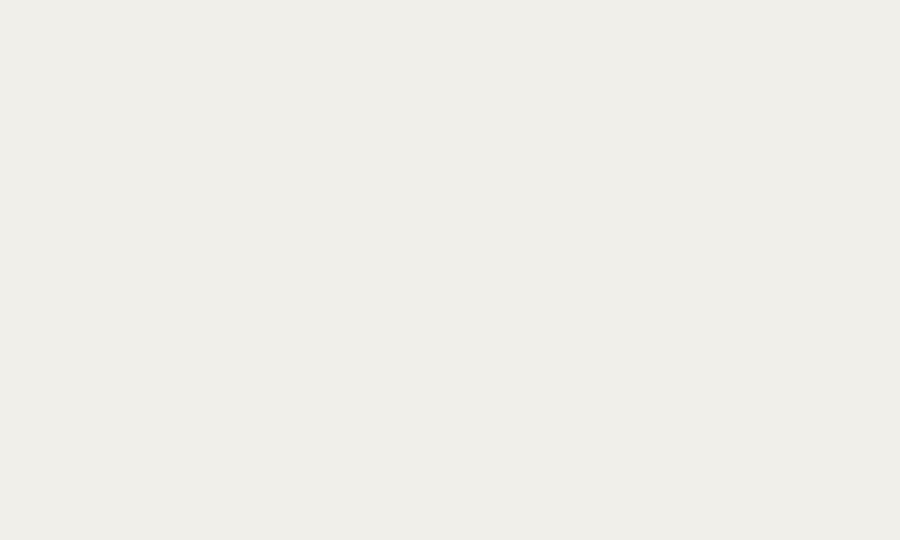
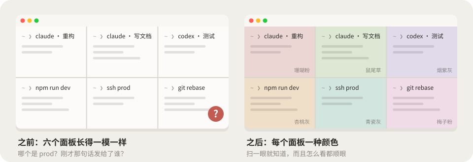
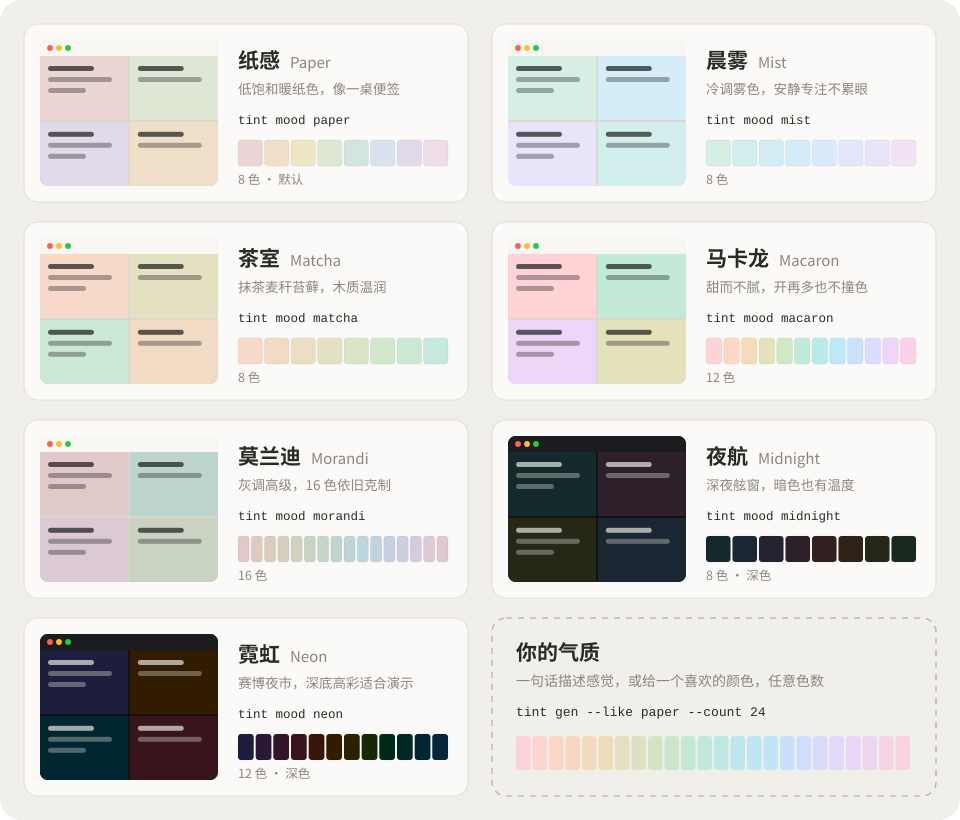
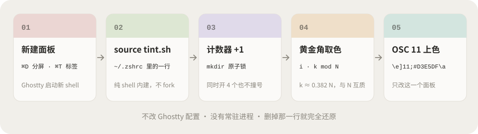
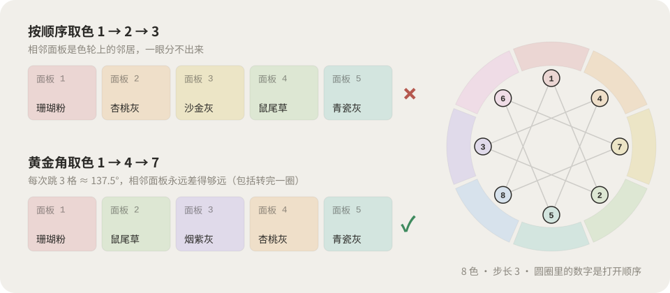

<div align="center" dir="rtl">

# ghostty-tint

**مع كل لوحة جديدة، لون هادئ جديد.**

يمنح كل لوحة مقسومة وكل تبويب في Ghostty لون خلفية ناعماً خاصاً به، فتعرف بنظرة واحدة ما الذي يجري في كل لوحة.

<a href="README.md">简体中文</a> · <a href="README.en.md">English</a> · <a href="README.ja.md">日本語</a> · <a href="README.ko.md">한국어</a> · <strong>العربية</strong>


</div>

<p align="center">
  
</p>

<p align="center" dir="rtl">
  <a href="#-التثبيت">التثبيت</a> ·
  <a href="#-الاستخدام">الاستخدام</a> ·
  <a href="#-سبعة-طوابع">الطوابع</a> ·
  <a href="#-اصنع-طابعك">التخصيص</a> ·
  <a href="#-ai-skill">AI Skill</a> ·
  <a href="#-كيف-يعمل">كيف يعمل</a> ·
  <a href="https://nevertoday.github.io/ghostty-tint/">لوحة الألوان على الويب</a>
</p>

<div dir="rtl">

## 😵 لماذا تحتاجه

ثلاث جلسات Claude، وجلسة Codex، وخادم تطوير، واتصال ssh بخادم الإنتاج، وكلها بالأسود على أبيض متطابق تماماً. ثم ترسل «احذف هذا الجدول»… لحظة، أي لوحة كانت هذه؟

<p align="center">
  
</p>

- **متناسقة.** كل الألوان لها السطوع والتشبّع نفسيهما في فضاء OKLCH، ولا يختلف إلا تدرّج اللون، فتنسجم أينما وُضعت.
- **مقروءة.** تباين النص لا يقل عن 12:1 في كل لوحة.
- **لا تتشابه الجارات.** تتقدّم كل لوحة جديدة على دائرة الألوان بالزاوية الذهبية (نحو 137.5°)، فلا يتجاور لونان متقاربان حتى بعد إكمال دورة كاملة.
- **عدد الألوان بيدك.** 8 أو 12 أو 16 أو 24… بأمر واحد.
- **خفيف.** ملف shell واحد، بلا اعتماديات ولا عمليات تعمل في الخلفية. احذف سطراً واحداً من ملف rc فيعود كل شيء كما كان.

## ⚡ التثبيت

```bash
curl -fsSL https://raw.githubusercontent.com/nevertoday/ghostty-tint/main/install.sh | bash
```

ثم اضغط <kbd>⌘</kbd> <kbd>D</kbd>. وإن أردت أن يتولى ذلك Claude Code أو Codex أو Cursor، فأرسل له هذا النص كما هو:

```text
Install ghostty-tint: https://github.com/nevertoday/ghostty-tint
Clone it, run `bash install.sh --skill`, then list the built-in moods.
If my ~/.zshrc already changes the background color, ask me before touching it.
```

تفضّل التثبيت يدوياً؟ يشرح [docs/manual.md](docs/manual.md) (بالصينية، والشيفرة تعمل كما هي) كل الطرق، من سطر `printf` واحد إلى نسخة مصغّرة من خمسة أسطر في zshrc.

## 🧭 الاستخدام

بعد التثبيت لا تحتاج إلى أي شيء، فكل لوحة جديدة تتلوّن تلقائياً. وللتحكم يدوياً:

| الأمر | ما يفعله |
|---|---|
| `tint` | اللون التالي |
| `tint random` | لون عشوائي، ولا يتكرر اللون نفسه مرتين متتاليتين |
| `tint 3` · `tint red` · `tint api` | حسب الرقم أو اسم اللون أو الاسم المستعار |
| `tint '#D7E2EC'` | أي لون |
| `tint reset` | العودة إلى لون السمة الافتراضي |
| `tint ls` · `tint mood` | قائمة الألوان · قائمة الطوابع |
| `tint mood mist` | تبديل الطابع للوحات القادمة |
| `tint gen …` | توليد طابع جديد |

## 🌈 سبعة طوابع

<p align="center">
  
</p>

بدّل الطابع بالأمر `tint mood <الاسم>`: ‏`paper` الورق (الافتراضي) · `mist` الضباب · `matcha` الماتشا · `macaron` الماكرون · `morandi` موراندي · `midnight` منتصف الليل · `neon` النيون. ويضبط الطابعان الداكنان أيضاً ألوان ANSI الستة عشر بدرجات أفتح.

## 🎨 اصنع طابعك

```bash
tint gen --like morandi --count 24 --name morandi24   # any mood, any number of colors
tint gen --seed '#D7E2EC' --count 12 --name sky        # grow a palette from one color
tint gen --l 0.89 --c 0.045 --hue 20 --span 110 --name kyoto
tint gen --check kyoto                                 # contrast and neighbor ΔE
tint mood kyoto
```

| المعامل | المعنى | قيم مرجعية |
|---|---|---|
| `--l` | السطوع، وكلما ارتفع صار أخف | الفاتح 0.86–0.94، الداكن 0.20–0.30 |
| `--c` | التشبّع، وكلما ارتفع صار أزهى | 0.015 شبه رمادي، 0.027 الورق، 0.05 الحلوى |
| `--hue` | تدرّج اللون الذي تبدأ منه | 0 وردي، 60 مشمشي، 150 أخضر، 240 أزرق، 310 بنفسجي |
| `--span` | كم درجة من دائرة الألوان تُستخدم | 360 الأوضح تمييزاً، 120 طابع أكثر وحدة |

مع `--name` يُحفظ الطابع مباشرة في `~/.config/ghostty-tint/moods/`، فتنتقل إليه فوراً بالأمر `tint mood`. وفي [لوحة الألوان على الويب](https://nevertoday.github.io/ghostty-tint/) تضبط الألوان بالمنزلقات وتعاينها، ثم تنسخ أمر التثبيت.

## 🤖 AI Skill

<p align="center">
  
</p>

شغّل `bash install.sh --skill` فتُثبَّت المهارة في `~/.claude/skills/` (وفي `~/.codex/skills/` إن كان Codex مثبتاً). بعدها صِف الإحساس الذي تريده بكلماتك:

- «أريد إحساس معبد في خريف كيوتو، ثمانية ألوان»
- «جنوب الصين بعد المطر، اثنا عشر لوناً»
- «ألوان داكنة تناسب عرضاً مباشراً في المساء»

يحوّل الوكيل وصفك إلى معاملات OKLCH، ويولّد الألوان، ويسمّي كل لون باسم من العالم نفسه، ويفحص التباين وفرق الألوان، ثم يعطيك سطر `tint mood` واحداً مع ثلاثة طوابع بديلة.

## 🔬 كيف يعمل

<p align="center">
  
</p>

1. يعمل `tint.sh` مرة واحدة عند بدء shell في كل لوحة. وهو يتذكّر الـ tty، فلا يتغيّر اللون إذا فتحت shell فرعياً في اللوحة نفسها.
2. يُزاد عدّاد مشترك في `$TMPDIR` تحت قفل `mkdir`، فلا تحصل لوحتان استُعيدتا في اللحظة نفسها على الرقم ذاته.
3. تأخذ اللوحة رقم i اللون رقم `(i × k) mod N`، حيث k هو أقرب عدد صحيح إلى 0.382 × N يكون أولياً نسبياً مع N. كونه أولياً نسبياً يعني أن كل لون يُستخدم مرة واحدة في الدورة، وكون k/N ≈ 0.382 يبعد كل لوحة عن جارتها نحو 137.5° على دائرة الألوان، وهي الزاوية التي تترتب بها بذور عباد الشمس.
4. يغيّر `printf '\e]11;#D3E5DF\a'` (OSC 11) خلفية تلك اللوحة وحدها.

<p align="center">
  
</p>

يعمل في أي طرفية تدعم OSC 11 بضبط `TINT_ANY_TERM=1`. وتمرير tmux مدعوم (وقد تحتاج إلى `set -g allow-passthrough on`). خيارات أخرى: `TINT_ORDER=random|seq|spread` و`TINT_AUTO=0` و`TINT_WASH=1` للمضيفات التي لا تلوّن اللوحات كلاً على حدة.

## 📄 الترخيص

**الاستخدام غير التجاري مجاني، والاستخدام التجاري يحتاج إلى إذن كتابي منفصل.** يُتاح ghostty-tint بموجب [PolyForm Noncommercial License 1.0.0](LICENSE). الشيفرة المصدرية متاحة للعموم، لكنه ليس برنامجاً مفتوح المصدر وفق تعريف OSI. الاستخدام الشخصي أو للهواية على جهازك مجاني. أما الاستخدام في عمل مدفوع، أو داخل شركة أو فريق، أو ضمن منتج تجاري، أو في دورات مدفوعة، فيحتاج إلى ترخيص. التفاصيل في [COMMERCIAL.md](COMMERCIAL.md) (بالصينية والإنجليزية).

Copyright (c) 2026 [小小东 Xiaoxiaodong](https://x.com/xiaoxiaodong01)

</div>
