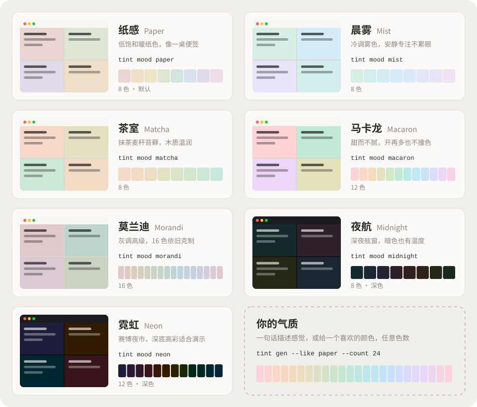
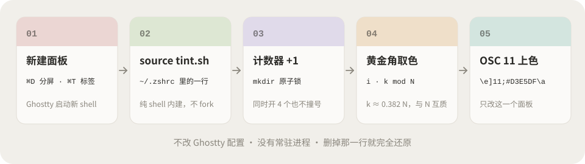
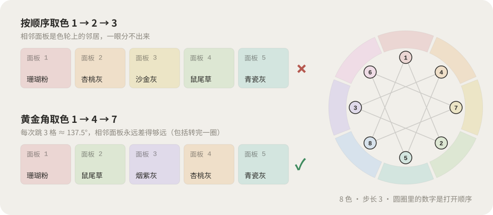

<div align="center">

# 🎨 ghostty-tint

### Every new pane gets its own quiet color.


Each Ghostty split and tab gets a soft background color of its own, so you can tell your four AI sessions, dev server and git pane apart at a glance.

[Install](#install) · [Moods](#moods) · [Playground](https://nevertoday.github.io/ghostty-tint/) · [中文](README.md)

</div>

## Before / after


## Why it looks good

- **Not random noise.** Every color shares the same OKLCH lightness and chroma; only the hue changes. So the colors always go together, and text has the same contrast on every pane (≥ 12:1).
- **Neighbors never clash.** New panes step around the hue wheel by the golden angle (~137.5°), so two panes next to each other never get near-identical colors, even when the cycle wraps around.
- **Any number of colors.** 8, 12, 16, 24… one command scales any mood to any size.
- **Tiny.** One shell file. No dependencies, no daemon, no changes to your Ghostty config. Delete one line to undo it all.

## Install

```bash
curl -fsSL https://raw.githubusercontent.com/nevertoday/ghostty-tint/main/install.sh | bash
```

Then hit <kbd>⌘</kbd><kbd>D</kbd>. Or paste this to Claude Code / Codex / Cursor:

```text
Install ghostty-tint (https://github.com/nevertoday/ghostty-tint): clone it, run `bash install.sh --skill`,
then list the built-in moods. If my ~/.zshrc already changes the background color, ask me before touching it.
```

Prefer doing it by hand? See [docs/manual.md](docs/manual.md) (Chinese, code is universal). It goes from a one-line `printf` up to a 5-line zshrc version.

## Usage

| Command | What it does |
|---|---|
| `tint` | next color (runs automatically in new panes) |
| `tint random` | random, never the same color twice in a row |
| `tint 3` · `tint red` · `tint api` | by index / hue name / alias |
| `tint '#D7E2EC'` | any color |
| `tint reset` | back to theme default |
| `tint ls` / `tint mood` | list colors / list moods |
| `tint mood mist` | switch mood for all future panes |
| `tint gen …` | generate a new mood |

## Moods





`paper` (default, 8) · `mist` (8) · `matcha` (8) · `macaron` (12) · `morandi` (16) · `midnight` (8, dark) · `neon` (12, dark)

## Make your own

```bash
tint gen --like morandi --count 24 --name morandi24 -o ~/.config/ghostty-tint/moods/morandi24.tint
tint gen --seed '#D7E2EC' --count 12 --name sky -o ~/.config/ghostty-tint/moods/sky.tint
tint gen --l 0.89 --c 0.045 --hue 20 --span 110 --count 8 --name kyoto -o ~/.config/ghostty-tint/moods/kyoto.tint
tint mood kyoto
```

`--l` lightness (light 0.86–0.94, dark 0.20–0.30) · `--c` chroma (0.015 greyish, 0.027 paper, 0.05 candy) · `--hue` start hue · `--span` degrees of the wheel (360 = most distinct).

Or use the [playground](https://nevertoday.github.io/ghostty-tint/): drag the sliders, open fake panes, then copy one command that installs the mood.


**AI Skill:** `bash install.sh --skill`, then just say *"I want the feeling of an autumn temple in Kyoto, 12 colors"*. The agent turns that into OKLCH parameters, names each color, checks contrast and ΔE, and hands you `tint mood kyoto` along with three alternative moods.

## How it works



1. `tint.sh` is sourced by your shell and runs once per pane (it tracks the tty, so subshells don't recolor).
2. A global counter in `$TMPDIR` is incremented under a `mkdir` lock, so panes restored at the same moment never get the same number.
3. Pane *i* takes color `(i × k) mod N`, where *k* is the integer closest to 0.382 × N that is coprime with N. Because k is coprime with N, every color is used once per cycle. Because k/N ≈ 0.382, neighbors sit about 137.5° apart, the same angle sunflower seeds use.
4. `printf '\e]11;#D3E5DF\a'` (OSC 11) recolors just that pane.



Works in any terminal that supports OSC 11 with `TINT_ANY_TERM=1`. tmux passthrough is handled for you (you may need `set -g allow-passthrough on`). Other options: `TINT_ORDER=random|seq|spread`, `TINT_AUTO=0`, `TINT_WASH=1` (for hosts that can't do per-split OSC 11).

## License

[MIT](LICENSE)
