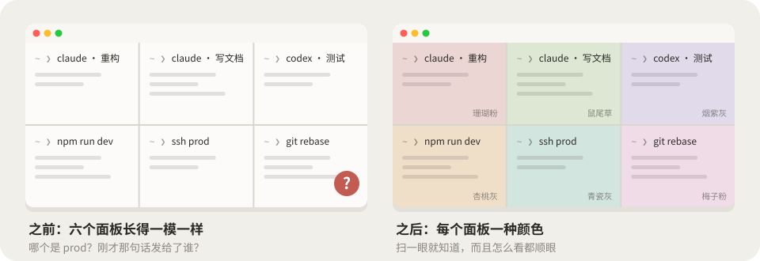
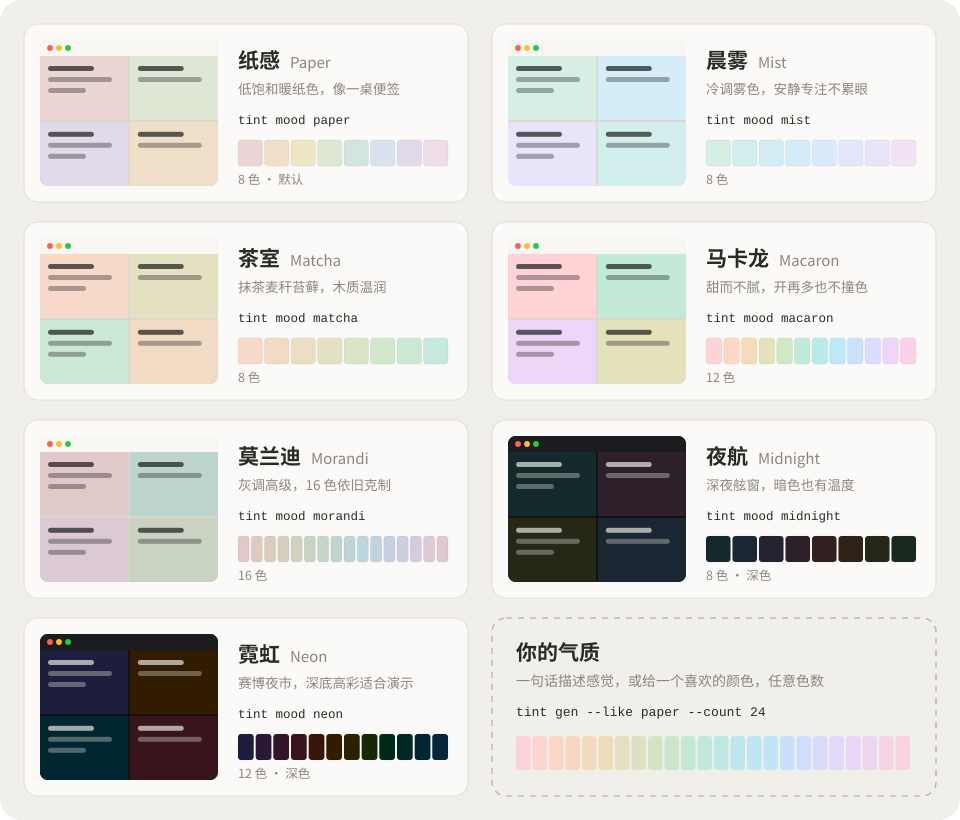
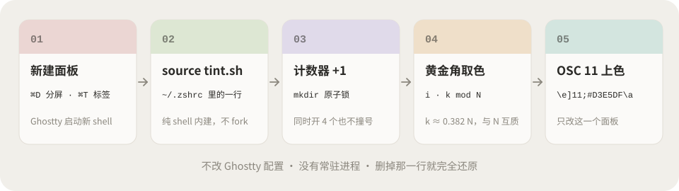
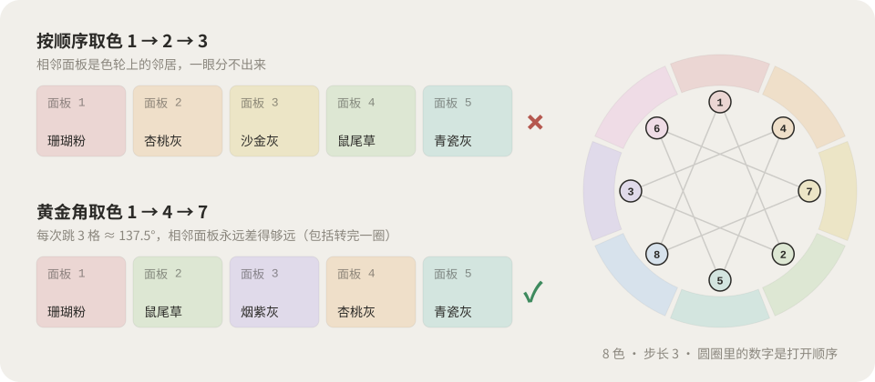

<div align="center">

# ghostty-tint

**新しいペインを開くたびに、静かな色をひとつ。**

Ghostty の分割ペインとタブに、淡い背景色を自動で割り当てます。どのペインで何をしているか、ひと目でわかります。

<a href="README.md">简体中文</a> · <a href="README.en.md">English</a> · <strong>日本語</strong> · <a href="README.ko.md">한국어</a> · <a href="README.ar.md">العربية</a>


</div>

<p align="center">
  
</p>

<p align="center">
  <a href="#-インストール">インストール</a> ·
  <a href="#-使い方">使い方</a> ·
  <a href="#-七つのムード">ムード</a> ·
  <a href="#-自分のムードを作る">カスタマイズ</a> ·
  <a href="#-ai-skill">AI Skill</a> ·
  <a href="#-しくみ">しくみ</a> ·
  <a href="https://nevertoday.github.io/ghostty-tint/">オンライン調色台</a>
</p>

## 😵 なぜ必要か

Claude が三つ、Codex がひとつ、dev サーバーに本番環境への ssh。全部まったく同じ白地に黒文字。そこで「このテーブルを削除して」と送信して……あれ、これはどのペインだっけ？

<p align="center">
  
</p>

- **調和する。** すべての色は OKLCH の明度と彩度が同じで、色相だけが違います。どう並んでも馴染みます。
- **読みやすい。** どのペインでも文字のコントラスト比は 12:1 以上です。
- **隣同士が似ない。** 新しいペインは黄金角（約 137.5°）ずつ色相環を進むので、一周して戻っても似た色が並びません。
- **色数は自由。** 8 色、12 色、16 色、24 色……コマンドひとつで決められます。
- **軽い。** シェルファイル一つだけ。依存なし、常駐プロセスなし。rc の一行を消せば元どおりです。

## ⚡ インストール

```bash
curl -fsSL https://raw.githubusercontent.com/nevertoday/ghostty-tint/main/install.sh | bash
```

あとは <kbd>⌘</kbd> <kbd>D</kbd> を押すだけです。Claude Code、Codex、Cursor に任せる場合は、次の文をそのまま渡してください：

```text
ghostty-tint をインストールして：https://github.com/nevertoday/ghostty-tint
リポジトリを clone して bash install.sh --skill を実行し、使えるムードを一覧で教えて。
~/.zshrc にすでに背景色を変える処理があれば、触る前に確認して。
```

スクリプトを使わずに手で入れたい場合は [docs/manual.md](docs/manual.md)（中国語、コードはそのまま使えます）をどうぞ。`printf` 一行の方法から、zshrc 5 行の最小版まで載っています。

## 🧭 使い方

インストール後は何もしなくても、新しいペインが自動で色づきます。手動で操作したいとき：

| コマンド | 動作 |
|---|---|
| `tint` | 次の色にする |
| `tint random` | ランダム（同じ色が二回続くことはない） |
| `tint 3` · `tint red` · `tint api` | 番号、色名、別名で指定 |
| `tint '#D7E2EC'` | 任意の色 |
| `tint reset` | テーマの既定色に戻す |
| `tint ls` · `tint mood` | 色の一覧 · ムードの一覧 |
| `tint mood mist` | ムードを切り替える（以後のペインに適用） |
| `tint gen …` | 新しいムードを生成 |

## 🌈 七つのムード

<p align="center">
  
</p>

`tint mood <名前>` で切り替えます：`paper` 紙（既定）· `mist` 朝霧 · `matcha` 茶室 · `macaron` マカロン · `morandi` モランディ · `midnight` 夜間飛行 · `neon` ネオン。二つのダーク系ムードは、明るめの ANSI 16 色もいっしょに設定します。

## 🎨 自分のムードを作る

```bash
tint gen --like morandi --count 24 --name morandi24   # どのムードも好きな色数に
tint gen --seed '#D7E2EC' --count 12 --name sky        # 好きな一色から広げる
tint gen --l 0.89 --c 0.045 --hue 20 --span 110 --name kyoto
tint gen --check kyoto                                 # コントラストと隣接色差をチェック
tint mood kyoto
```

| 引数 | 意味 | 目安 |
|---|---|---|
| `--l` | 明度。高いほど軽やか | ライト 0.86–0.94、ダーク 0.20–0.30 |
| `--c` | 彩度。高いほど鮮やか | 0.015 ほぼグレー、0.027 紙、0.05 キャンディ |
| `--hue` | 開始する色相 | 0 ピンク、60 杏、150 緑、240 青、310 紫 |
| `--span` | 色相環を何度ぶん使うか | 360 が最も見分けやすい、120 はテーマ感が出る |

`--name` を付けると `~/.config/ghostty-tint/moods/` に保存され、すぐ `tint mood` で切り替えられます。[オンライン調色台](https://nevertoday.github.io/ghostty-tint/)では、スライダーで色を調整してプレビューし、インストール用のコマンドをコピーできます。

## 🤖 AI Skill

<p align="center">
  
</p>

`bash install.sh --skill` で Skill が `~/.claude/skills/` に入ります（Codex があれば `~/.codex/skills/` にも）。あとは雰囲気を言葉で伝えるだけです：

- 「京都の秋の寺のような雰囲気で、8 色」
- 「雨上がりの江南、12 色」
- 「夜の配信デモに向いたダークな配色」

AI が言葉を OKLCH のパラメータに置き換えて色を生成し、同じ世界観の名前を付け、コントラストと色差をチェックしたうえで、`tint mood` の一行と三つの代替ムードを返します。

## 🔬 しくみ

<p align="center">
  
</p>

1. `tint.sh` はシェルの起動時に一度だけ実行されます。tty を覚えているので、同じペインでサブシェルを開いても色は変わりません。
2. `$TMPDIR` にある共通のカウンターを、`mkdir` をロックにして一つ進めます。同時に復元された複数のペインが同じ番号になることはありません。
3. i 番目のペインは `(i × k) mod N` 番目の色を使います。k は 0.382 × N に最も近く、N と互いに素な整数です。互いに素なので一周で全色を一度ずつ使い、k/N ≈ 0.382 なので隣のペインとは色相環で約 137.5° 離れます。ひまわりの種の並びと同じ角度です。
4. `printf '\e]11;#D3E5DF\a'`（OSC 11）で、そのペインの背景だけを変えます。

<p align="center">
  
</p>

OSC 11 に対応した端末なら `TINT_ANY_TERM=1` で Ghostty 以外でも使えます。tmux のパススルーにも対応しています（必要なら `set -g allow-passthrough on`）。そのほかのオプション：`TINT_ORDER=random|seq|spread`、`TINT_AUTO=0`、`TINT_WASH=1`（ペインごとの OSC 11 に対応しないホスト向け）。

## 📄 ライセンス

**非商用は無料、商用利用には別途書面での許諾が必要です。** ghostty-tint は [PolyForm Noncommercial License 1.0.0](LICENSE) で提供しています。ソースは公開していますが、OSI の定義するオープンソースではありません。自分のパソコンでの個人利用や趣味での利用は無料です。有償の仕事、会社やチームでの利用、商用製品への組み込み、有料講座での利用には許諾が必要です。詳しくは [COMMERCIAL.md](COMMERCIAL.md)（中国語・英語）をご覧ください。

Copyright (c) 2026 [小小东 Xiaoxiaodong](https://x.com/xiaoxiaodong01)
