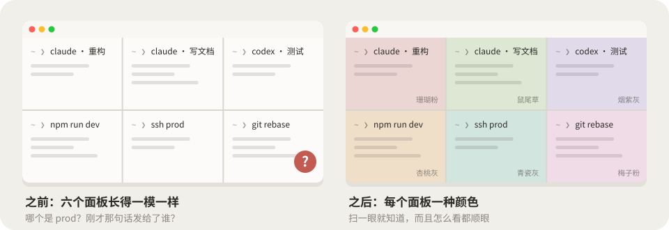
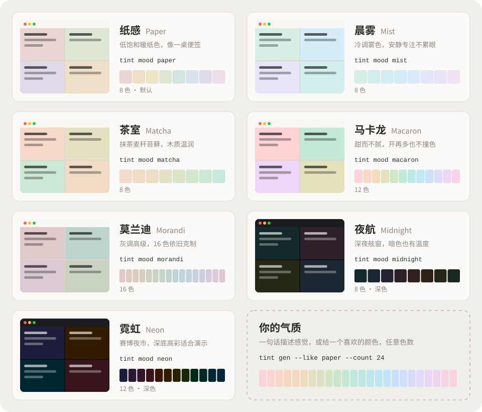
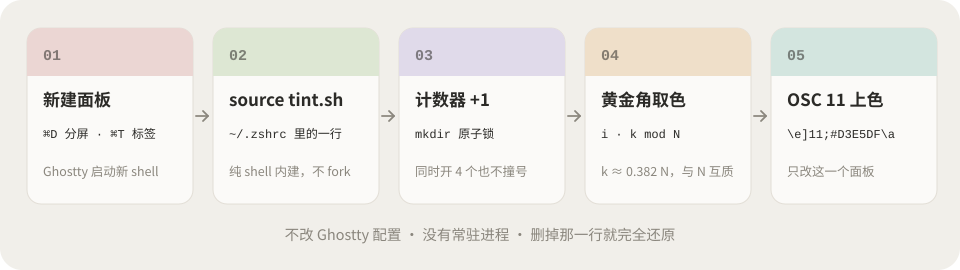
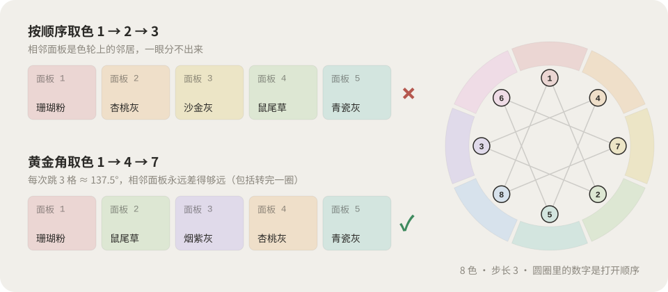

<div align="center">

# ghostty-tint

**새 패널을 열 때마다, 조용한 색 하나.**

Ghostty의 분할 패널과 탭마다 은은한 배경색을 자동으로 입혀 줍니다. 어느 패널에서 무엇을 하는지 한눈에 알 수 있습니다.

<a href="README.md">简体中文</a> · <a href="README.en.md">English</a> · <a href="README.ja.md">日本語</a> · <strong>한국어</strong> · <a href="README.ar.md">العربية</a>


</div>

<p align="center">
  
</p>

<p align="center">
  <a href="#-설치">설치</a> ·
  <a href="#-사용법">사용법</a> ·
  <a href="#-일곱-가지-무드">무드</a> ·
  <a href="#-나만의-무드-만들기">커스터마이즈</a> ·
  <a href="#-ai-skill">AI Skill</a> ·
  <a href="#-작동-원리">원리</a> ·
  <a href="https://nevertoday.github.io/ghostty-tint/">온라인 팔레트</a>
</p>

## 😵 왜 필요할까

Claude 세 개, Codex 하나, dev 서버, 그리고 운영 환경에 붙은 ssh까지. 전부 똑같은 흰 바탕에 검은 글씨입니다. 그러다 "이 테이블 지워 줘"를 보냈는데…… 잠깐, 이게 어느 패널이었더라?

<p align="center">
  
</p>

- **조화롭습니다.** 모든 색이 OKLCH 기준으로 명도와 채도가 같고 색상만 다릅니다. 어떻게 배치돼도 잘 어울립니다.
- **잘 읽힙니다.** 어느 패널에서나 글자 대비는 12:1 이상입니다.
- **옆 패널과 겹치지 않습니다.** 새 패널은 황금각(약 137.5°)씩 색상환을 이동하므로, 한 바퀴 돌아와도 비슷한 색이 나란히 오지 않습니다.
- **색상 수는 자유입니다.** 8색, 12색, 16색, 24색…… 명령 하나로 정합니다.
- **가볍습니다.** 셸 파일 하나뿐입니다. 의존성도 상주 프로세스도 없고, rc 파일의 한 줄만 지우면 원래대로 돌아갑니다.

## ⚡ 설치

```bash
curl -fsSL https://raw.githubusercontent.com/nevertoday/ghostty-tint/main/install.sh | bash
```

그다음 <kbd>⌘</kbd> <kbd>D</kbd>만 누르면 됩니다. Claude Code, Codex, Cursor에 맡기려면 아래 문장을 그대로 보내세요:

```text
ghostty-tint를 설치해 줘: https://github.com/nevertoday/ghostty-tint
저장소를 clone하고 bash install.sh --skill을 실행한 뒤, 고를 수 있는 무드를 알려 줘.
~/.zshrc에 이미 배경색을 바꾸는 코드가 있으면 건드리기 전에 먼저 물어봐 줘.
```

스크립트 없이 직접 설치하고 싶다면 [docs/manual.md](docs/manual.md)(중국어, 코드는 그대로 사용 가능)를 참고하세요. `printf` 한 줄부터 zshrc 5줄짜리 최소 버전까지 정리해 두었습니다.

## 🧭 사용법

설치 후에는 아무것도 하지 않아도 새 패널에 자동으로 색이 입혀집니다. 직접 조작하고 싶을 때:

| 명령 | 동작 |
|---|---|
| `tint` | 다음 색으로 |
| `tint random` | 무작위 (같은 색이 연속으로 나오지 않음) |
| `tint 3` · `tint red` · `tint api` | 번호, 색 이름, 별칭으로 지정 |
| `tint '#D7E2EC'` | 원하는 색 |
| `tint reset` | 테마 기본색으로 복원 |
| `tint ls` · `tint mood` | 색 목록 · 무드 목록 |
| `tint mood mist` | 무드 전환 (이후 여는 패널에 적용) |
| `tint gen …` | 새 무드 생성 |

## 🌈 일곱 가지 무드

<p align="center">
  
</p>

`tint mood <이름>`으로 전환합니다: `paper` 종이(기본) · `mist` 새벽안개 · `matcha` 다실 · `macaron` 마카롱 · `morandi` 모란디 · `midnight` 야간비행 · `neon` 네온. 어두운 무드 두 가지는 더 밝은 ANSI 16색도 함께 적용합니다.

## 🎨 나만의 무드 만들기

```bash
tint gen --like morandi --count 24 --name morandi24   # 어떤 무드든 원하는 색상 수로
tint gen --seed '#D7E2EC' --count 12 --name sky        # 좋아하는 색 하나에서 출발
tint gen --l 0.89 --c 0.045 --hue 20 --span 110 --name kyoto
tint gen --check kyoto                                 # 대비와 인접 색차 점검
tint mood kyoto
```

| 인자 | 의미 | 참고값 |
|---|---|---|
| `--l` | 명도. 높을수록 가벼움 | 밝은 무드 0.86–0.94, 어두운 무드 0.20–0.30 |
| `--c` | 채도. 높을수록 선명함 | 0.015 거의 회색, 0.027 종이, 0.05 캔디 |
| `--hue` | 시작 색상 | 0 분홍, 60 살구, 150 초록, 240 파랑, 310 보라 |
| `--span` | 색상환을 몇 도까지 쓸지 | 360이 가장 구분 잘 됨, 120은 테마 느낌 |

`--name`을 주면 `~/.config/ghostty-tint/moods/`에 바로 저장되어 곧장 `tint mood`로 바꿀 수 있습니다. [온라인 팔레트](https://nevertoday.github.io/ghostty-tint/)에서는 슬라이더로 색을 조정하고 미리 본 뒤, 설치 명령을 복사할 수 있습니다.

## 🤖 AI Skill

<p align="center">
  
</p>

`bash install.sh --skill`을 실행하면 Skill이 `~/.claude/skills/`에 설치됩니다(Codex가 있으면 `~/.codex/skills/`에도). 그다음 원하는 분위기를 말로 전하면 됩니다:

- "교토 가을 사찰 같은 느낌으로, 8색"
- "비 갠 뒤의 강남, 12색"
- "밤에 라이브 데모하기 좋은 어두운 배색"

AI가 설명을 OKLCH 파라미터로 바꿔 색을 만들고, 같은 세계관의 이름을 붙이고, 대비와 색차를 점검한 뒤, `tint mood` 한 줄과 대안 무드 세 가지를 알려 줍니다.

## 🔬 작동 원리

<p align="center">
  
</p>

1. `tint.sh`는 셸이 시작될 때 한 번만 실행됩니다. tty를 기억하므로 같은 패널에서 서브셸을 열어도 색이 바뀌지 않습니다.
2. `$TMPDIR`에 있는 공용 카운터를 `mkdir` 잠금으로 하나 올립니다. 동시에 복원된 패널들이 같은 번호를 받는 일이 없습니다.
3. i번째 패널은 `(i × k) mod N`번째 색을 씁니다. k는 0.382 × N에 가장 가까우면서 N과 서로소인 정수입니다. 서로소이므로 한 바퀴에 모든 색을 한 번씩 쓰고, k/N ≈ 0.382이므로 옆 패널과 색상환에서 약 137.5° 떨어집니다. 해바라기 씨앗이 배열되는 각도와 같습니다.
4. `printf '\e]11;#D3E5DF\a'`(OSC 11)로 해당 패널의 배경만 바꿉니다.

<p align="center">
  
</p>

OSC 11을 지원하는 터미널이라면 `TINT_ANY_TERM=1`로 Ghostty 밖에서도 쓸 수 있습니다. tmux 패스스루도 지원합니다(필요하면 `set -g allow-passthrough on`). 그 밖의 옵션: `TINT_ORDER=random|seq|spread`, `TINT_AUTO=0`, `TINT_WASH=1`(패널별 OSC 11을 지원하지 않는 호스트용).

## 📄 라이선스

**비상업적 사용은 무료이며, 상업적 사용은 별도의 서면 허가가 필요합니다.** ghostty-tint는 [PolyForm Noncommercial License 1.0.0](LICENSE)으로 제공됩니다. 소스는 공개되어 있지만 OSI가 정의하는 오픈소스는 아닙니다. 자신의 컴퓨터에서 개인적으로 또는 취미로 쓰는 것은 무료입니다. 유료 업무, 회사나 팀 내부 사용, 상용 제품에 통합, 유료 강의에서 사용하려면 허가가 필요합니다. 자세한 내용은 [COMMERCIAL.md](COMMERCIAL.md)(중국어·영어)를 참고하세요.

Copyright (c) 2026 [小小东 Xiaoxiaodong](https://x.com/xiaoxiaodong01)
