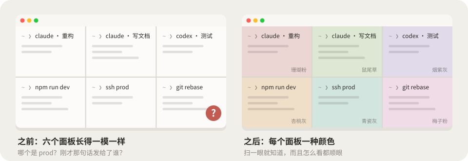
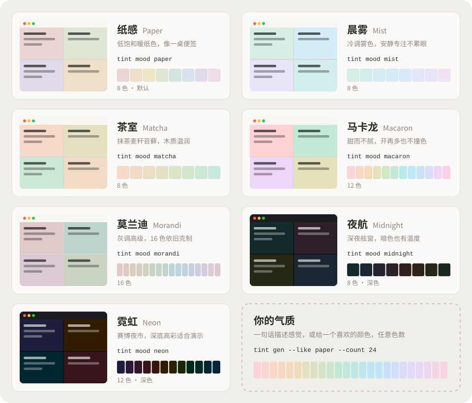
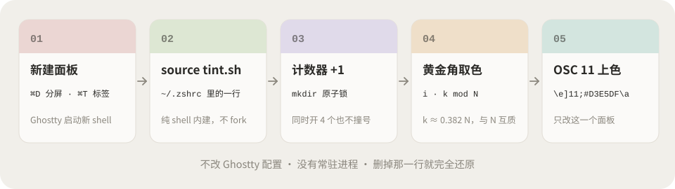
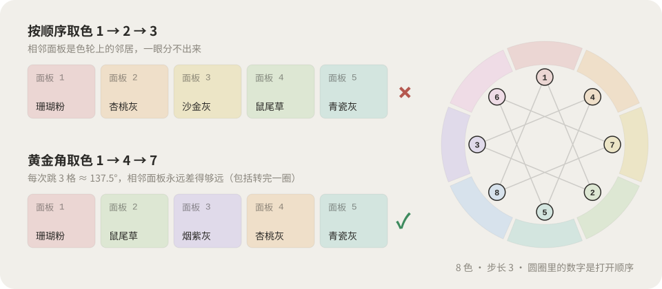

<div align="center">

# 🎨 ghostty-tint

### 每开一个面板，换一种安静的颜色。


<sub>↑ 按 <kbd>⌘</kbd><kbd>D</kbd>，新面板自己就换好了颜色；一条 <code>tint mood</code> 换掉整个气质</sub>

<br><br>

[⚡ 30 秒装好](#-30-秒装好) · [🌈 七种气质](#-七种气质) · [🤖 AI Skill](#-ai-skill一句话要一种气质) · [🎛️ 在线调色台](https://nevertoday.github.io/ghostty-tint/) · [💬 AI 话术](PROMPT.md) · [🛠️ 手动方案](docs/manual.md) · [English](README.en.md)


</div>

---

## 😵 你是不是也这样

同时开着三个 Claude、一个 Codex、一个 dev server，外加一个连着生产环境的 ssh。全都是一模一样的白底黑字，然后你把「删掉这张表」发给了……等等，这个是哪个面板来着？



**ghostty-tint 给每个新面板自动配一块低饱和背景色。** 颜色就是最快的标签：不用读标题，余光一扫就知道哪个是哪个。

## ✨ 为什么不是「随便换个色」

| | 随便随机 | ghostty-tint |
|---|---|---|
| 好不好看 | 撞上荧光绿就很刺眼 | 亮度、彩度完全一致，只换色相，**怎么组合都协调** |
| 看不看得清字 | 看运气 | 文字对比度 **≥ 12 : 1**，每个面板一样清楚 |
| 相邻会不会撞色 | 经常两个差不多的挨着 | 按 **黄金角 137.5°** 取色，转完一圈也不撞 |
| 颜色几个 | 写死 | **8 / 12 / 16 / 24…** 一条命令随你定 |
| 有多重 | 插件、守护进程 | **一个 shell 文件**，零依赖，删一行就还原 |

## ⚡ 30 秒装好

**🤖 方式一：让 AI 帮你装（推荐）**：把这段话丢给 Claude Code / Codex / Cursor：

```text
帮我安装 ghostty-tint（https://github.com/nevertoday/ghostty-tint），让 Ghostty 每个新面板自动换一种低饱和背景色。
请克隆仓库后运行 bash install.sh --skill，然后告诉我有哪些气质可以选。
如果我的 ~/.zshrc 里已经有别的改背景色的逻辑，先问我要不要注释掉。
```

> 💬 想从零实现、定制气质、改颜色数量、排查问题？**[PROMPT.md](PROMPT.md)** 里有 7 段现成话术，复制就能用。

**⌨️ 方式二：一行命令**

```bash
curl -fsSL https://raw.githubusercontent.com/nevertoday/ghostty-tint/main/install.sh | bash
```

然后按 <kbd>⌘</kbd><kbd>D</kbd>。就这样，没有第三步。🎉

**🛠️ 方式三：手动**：不想跑任何脚本？[docs/manual.md](docs/manual.md) 从「一条 printf 换色」讲到「5 行 zshrc 极简版」。

## 🌈 七种气质



<sub>↑ 这张是动画，七种气质轮流播放</sub>



| | 气质 | 一句话 | 色数 | 切换 |
|---|---|---|---|---|
| 📜 | **纸感 Paper**（默认） | 低饱和暖纸色，像一桌便签 | 8 | `tint mood paper` |
| 🌫️ | **晨雾 Mist** | 冷调雾色，安静专注不累眼 | 8 | `tint mood mist` |
| 🍵 | **茶室 Matcha** | 抹茶麦秆苔藓，木质温润 | 8 | `tint mood matcha` |
| 🧁 | **马卡龙 Macaron** | 甜而不腻，开再多也不撞色 | 12 | `tint mood macaron` |
| 🏺 | **莫兰迪 Morandi** | 灰调高级，16 色依旧克制 | 16 | `tint mood morandi` |
| 🌙 | **夜航 Midnight** | 深夜舷窗，暗色也有温度 | 8 · 深色 | `tint mood midnight` |
| 🌆 | **霓虹 Neon** | 赛博夜市，深底高彩适合演示 | 12 · 深色 | `tint mood neon` |

深色气质会顺带把 ANSI 16 色换成更亮的一套，`ls`、`git diff` 在深底上照样清楚。

## 🤖 AI Skill：一句话要一种气质


`bash install.sh --skill` 会把 Skill 装进 `~/.claude/skills/`（有 Codex 的话也装进 `~/.codex/skills/`）。然后你只要说人话：

> 🍁「我想要京都秋天寺庙的感觉，8 个颜色」<br>
> 🌧️「来一套雨后江南，12 色」<br>
> 📺「给我一个适合晚上直播演示的深色配色」<br>
> 🔢「把现在的配色改成 24 色」

AI 会把描述翻译成 OKLCH 参数，生成色板，给每个颜色起一个同一世界观的名字（枫红、朱鹭、柿色、金阁、苔庭……），跑完对比度和色差体检，再给你一行 `tint mood kyoto`，**外加 3 个备选气质**。Skill 文件：[skills/ghostty-tint/SKILL.md](skills/ghostty-tint/SKILL.md)。

## 🎛️ 自己调一种

**在线调色台**：[nevertoday.github.io/ghostty-tint](https://nevertoday.github.io/ghostty-tint/)。拖滑杆，点「开新面板」看效果（也可以真的按 <kbd>⌘</kbd><kbd>D</kbd>），满意了复制一段命令粘贴进终端，就装好了。

**一条命令**：任何气质都能改色数，也能从一个你喜欢的颜色长出一整套：

```bash
tint gen --like morandi --count 24 --name morandi24 -o ~/.config/ghostty-tint/moods/morandi24.tint
tint gen --seed '#D7E2EC' --count 12 --name sky -o ~/.config/ghostty-tint/moods/sky.tint
tint gen --l 0.89 --c 0.045 --hue 20 --span 110 --count 8 --name kyoto --title "京都秋 Kyoto" \
         -o ~/.config/ghostty-tint/moods/kyoto.tint
tint mood kyoto
```

| 参数 | 含义 | 参考 |
|---|---|---|
| `--l` 亮度 | 越高越轻盈 | 浅色 0.86–0.94 · 深色 0.20–0.30 |
| `--c` 彩度 | 越高越鲜艳 | 0.015 近灰 · 0.027 纸感 · 0.05 糖果 |
| `--hue` 起始色相 | 从哪个颜色开始 | 0 粉红 · 60 杏 · 150 绿 · 240 蓝 · 310 紫 |
| `--span` 跨度 | 绕色轮多少度 | 360 最好区分 · 120 更有主题感 |

体检一下：`python3 ~/.config/ghostty-tint/tint-gen.py --check ~/.config/ghostty-tint/moods/kyoto.tint`，它会告诉你最低对比度和相邻面板的色差够不够。

**手写也行**：`.tint` 就是个纯文本文件，一行一个颜色，想写几个写几个：

```text
name  京都秋 Kyoto
vibe  旧木与枫叶，暖而不燥
fg    #1A1A1A

bg    #F7D0CE  枫红  maple red
bg    #F0D6BC  柿色  persimmon orange
bg    #E2DCBA  金阁  gold yellow
#     … 按色相顺序排好即可，tint 会自动打散
```

## 🕹️ 命令速查

装好以后什么都不用做，**新面板会自动换色**。想手动玩：

| 命令 | 作用 |
|---|---|
| `tint` | 换下一个颜色 |
| `tint random` | 随机换一个（不会连续两次同色） |
| `tint 3` · `tint red` · `tint 后端` | 指定第几色 / 按名字 / 按别名 |
| `tint '#D7E2EC'` | 任意颜色 |
| `tint reset` | 恢复主题默认 |
| `tint ls` | 看当前气质的所有颜色 |
| `tint mood` · `tint mood mist` | 列出全部气质 / 切换气质 |
| `tint gen …` | 生成新气质 |

🏷️ 默认「纸感」还给每个颜色起了任务别名，拿来给面板标用途刚好：`tint prod` 珊瑚粉 · `tint dev` 鼠尾草 · `tint api` 青瓷灰 · `tint test` 雾蓝灰 · `tint doc` 烟紫灰 · `tint ui` 梅子粉。

## 🔬 它是怎么做到的



1. **每个面板都是一个新 shell。** `~/.zshrc` 里 source 了 `tint.sh`，它在 shell 启动时跑一次（同一个面板里再开子 shell 不会重复换色）。
2. **全局计数器 +1。** 计数器在 `$TMPDIR` 里，`mkdir` 当原子锁，同时恢复 4 个窗口也不会两个面板拿到同一个号。
3. **黄金角取色。** 第 i 个面板取第 `(i × k) mod N` 个颜色，k 是最接近 0.382 × N 且与 N 互质的整数（8 色 k=3，12 色 k=5，16 色 k=7）。互质保证转一圈每个颜色正好用一次；k/N ≈ 0.382 让相邻面板在色轮上差约 137.5°，也就是 **🌻 向日葵种子的排列角度**。
4. **OSC 11 上色。** `printf '\e]11;#D3E5DF\a'` 是终端的标准转义序列，只改当前面板的背景，不碰全局配置、不需要重载。



<sub>↑ 8 色时的取色路径正好画出一颗八角星 ⭐</sub>

## ❓ 常见问题

<details><summary><b>已经打开的面板没变色？</b></summary>

只有新面板会自动换。当前面板想立刻试：`source ~/.zshrc && tint`。
</details>

<details><summary><b>不用 Ghostty 可以吗？</b></summary>

可以。iTerm2、WezTerm、kitty、Alacritty、foot 等支持 OSC 11 的终端都行，在 source 之前加 `export TINT_ANY_TERM=1`。
</details>

<details><summary><b>tmux 里能用吗？</b></summary>

能，tint 会自动用 tmux 透传序列。如果没效果，在 `~/.tmux.conf` 加 `set -g allow-passthrough on`。
</details>

<details><summary><b>想要纯随机，或者按顺序？</b></summary>

`export TINT_ORDER=random`（随机，但不会连续两次同色）或 `TINT_ORDER=seq`。默认 `spread`（黄金角）。
</details>

<details><summary><b>不想自动换，只想要 tint 命令？</b></summary>

`export TINT_AUTO=0`。
</details>

<details><summary><b>在 cmux 等嵌入 Ghostty 的应用里，所有分屏变成同一个颜色？</b></summary>

部分旧版本不能给每个分屏单独设置 OSC 11 背景。设 `export TINT_WASH=1`，tint 会改用单元格底色铺满面板。
</details>

<details><summary><b>颜色看起来很淡？</b></summary>

检查 Ghostty 的 `background-opacity`，小于 1 时颜色会被透明度冲淡。想要更明显的颜色，换 `macaron`，或者用 `tint gen --c 0.05` 提高彩度。
</details>

<details><summary><b>怎么卸载？</b></summary>

`bash ~/.config/ghostty-tint/install.sh --uninstall`。它会删掉配置目录、rc 里的那几行和 Skill，干干净净。
</details>

## 📦 项目结构

```text
tint.sh              核心，被 source 进 rc（约 360 行纯 shell，含注释）
moods/*.tint         7 种内置气质
tools/tint-gen.py    气质生成器 / 体检 / 预览（只用 Python 标准库）
tools/build.py       从 moods/ 生成 assets/*.svg，同步调色台和 Skill
tools/make_gifs.py   逐帧渲染 tools/gif/stage.html，合成 assets/*.gif
install.sh           安装 / 卸载
skills/ghostty-tint/ AI Skill（自带一份完整文件，可单独拷走）
docs/index.html      在线调色台（GitHub Pages）
docs/manual.md       手动方案
PROMPT.md            AI 话术
```

图都是从 `moods/` 生成的：改了气质，跑一下 `python3 tools/build.py`（SVG、调色台、Skill）和 `python3 tools/make_gifs.py`（GIF），文档就跟着更新。

## 🙌 致谢 & 贡献

默认的「纸感」八色来自作者日常使用的 Otty Paper 浅色主题。欢迎 PR 你调出来的气质：放进 `moods/`，跑一下 `build.py`，就会出现在图鉴里。

## 📄 License

[MIT](LICENSE)
